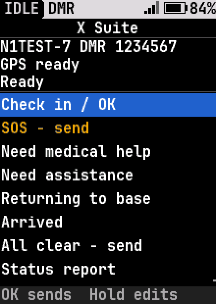
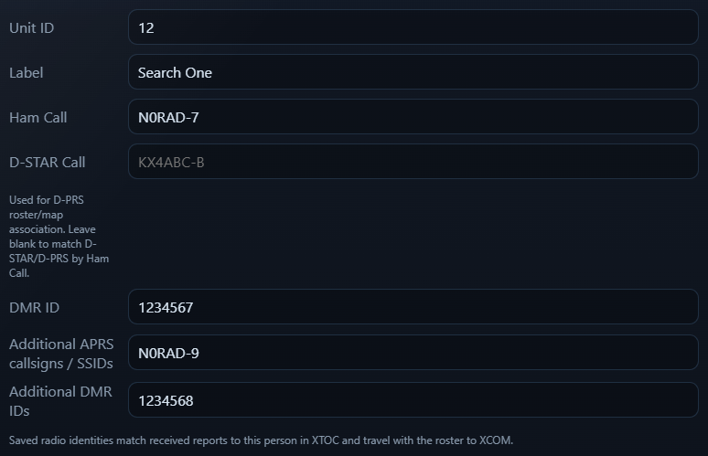

<!-- SPDX-License-Identifier: MIT -->
<!-- Copyright (c) 2026 The RadioFoundry Authors -->
<!-- Copyright (c) 2026 MKME Media -->
# X Suite Radio for DM-32UV

**Firmware flasher: BETA — Use at your own risk.** Make and retain an original radio backup before installation or updates.

X Suite Radio connects the DM-32UV handheld to XTOC and XCOM through APRS / AX.25 and DMR data. Send automatic check-ins, select a quick field report or SOS on the radio, and send messages and tasking back from the application's familiar packet composer.

This is the MKME Media fork of [RadioFoundry](https://github.com/RadioFoundry/RadioFoundry), preserving its history and MIT license. Our maintained default branch is **`codex/xsuite-radio`**. The upstream project and its [original README](README.upstream.md) remain the reference for RadioFoundry's wider hardware and firmware features.

## Use it with your team

Save the radio's APRS callsign/SSID or DMR ID against a person in **Team** once. XTOC and XCOM use that transmitted identity to match incoming reports to the person and their team/squad. Shared roster exports and backups carry the assignments with them.

Use an XTOC or XCOM build that includes X Suite Radio support. Open **Digi Modes → APRS → X Suite Radio** in XTOC. In XCOM, open the APRS **Bridge connection** choices and select **X Suite radio · programming cable**. The installed application discovers the radio, manages its connection, saves its reporting settings and supplies firmware backup, installation and recovery controls. The [illustrated operator guide](docs/xsuite/operator-guide.md) walks through the complete workflow; keep its [printable PDF](docs/xsuite/dm32-xsuite-radio-guide.pdf) with your field kit.

*Actual firmware simulator and application captures with demonstration data. The guide labels simulated devices and received traffic beside each illustration.*

The firmware provides nineteen preset actions: check-in, SOS, medical help, assistance, returning to base, arrival, all clear, status, observation, water, food, fuel, medical supplies, transport, equipment, task acknowledged, task completed, received reply and hazard. Hold **OK** on a report to edit its short note, quantity or priority; **Write message** opens the radio's existing text editor. Automatic check-ins have saved interval and movement choices, and SOS remains active until an explicit all-clear report.

XTOC and XCOM retain their existing packet encoders and composers. Choose a saved person, squad, all saved team radios or the selected radio channel when sending from the application. On the radio, **Received reports** shows the decoded message or report preview.

## Source and instructions

| Start here | What it covers |
| --- | --- |
| [Operator guide](docs/xsuite/operator-guide.md) · [PDF](docs/xsuite/dm32-xsuite-radio-guide.pdf) | Team identities, backup/install/recovery, automatic reports, SOS and two-way sends |
| [Build from source](docs/xsuite/building.md) | Standalone DM-32UV firmware build, local tests and the separate canonical application check |
| [Pull RadioFoundry updates](docs/xsuite/upstream.md) | Clone layout, origin/upstream remotes, ordinary merges and release checks |
| [Technical integration](XSUITE.md) | Cable protocol, packet identity, settings and source layout |
| [Contribute or report a problem](docs/xsuite/contributing.md) | Focused changes and useful reproduction details |
| [RadioFoundry documentation](docs/README.md) | The inherited radio platform, hardware and developer reference |

The source includes generated packet templates so a standalone firmware build can use this repository directly. Maintainers regenerate those templates through the existing XTOC encoders when the application protocol changes. Updates are merged from RadioFoundry with both histories retained; the [upstream guide](docs/xsuite/upstream.md) explains the process.

## Layout

| Path | Purpose |
| --- | --- |
| [core/xsuite](core/xsuite) | Report generation, saved profile, delivery state and native host interface |
| [core/ui/ui_xsuite.c](core/ui/ui_xsuite.c) | The radio's X Suite menu and report editor |
| [config/variants/xsuite.mk](config/variants/xsuite.mk) | The X Suite feature selection |
| [tools/xsuite](tools/xsuite) | Canonical template generation, installer, update and validation tools |
| [tests/host](tests/host) | Shared host tests and X Suite packet, runtime, UI and installer checks |
| [docs/xsuite](docs/xsuite) | The operator guide, screenshots and fork maintenance instructions |

The [original RadioFoundry layout](README.upstream.md#layout) describes the shared radio core, board layers, drivers and host tools.

## License and attribution

[MIT](LICENSE), with the RadioFoundry authors' copyright and [AUTHORS](AUTHORS) / [CONTRIBUTORS](CONTRIBUTORS) records retained. X Suite additions are copyright 2026 MKME Media. Bundled third-party components retain their individual notices. Each radio's voice codec is retained through its own local backup during installation and recovery.
