<!-- SPDX-License-Identifier: MIT -->
<!-- Copyright (c) 2026 The RadioFoundry Authors -->
<!-- Copyright (c) 2026 MKME Media -->

# DM-32UV X Suite Radio operator guide

Use a DM-32UV to send positions, check-ins, assistance reports and short field messages to XTOC or XCOM. The receiving application matches the callsign or DMR ID already carried by the radio transmission to a saved person in Team. The person's team and squad come from that roster entry.

Keep this guide with the installed application. XTOC's **Digi Modes → APRS → X Suite Radio → Radio guide** opens the local copy; XCOM's Help contains the same guide. Both HTML and printable PDF include the illustrated setup and operating steps.

## Set the person once

1. Open **Team** in XTOC, or **XTOC Data → Team · people and radio identities** in XCOM, and select the person. XCOM's normal Comms composer also provides **Team…**.
2. Enter the radio's exact APRS callsign and SSID in **Ham Call** or **Additional APRS callsigns / SSIDs**. For example, the portable and vehicle radios can have different SSIDs assigned to the same person.
3. Enter **DMR ID** when that person uses DMR. Use **Additional DMR IDs** for another radio belonging to the same person.
4. Save the person. Set their team/squad membership in the normal roster controls.
5. Share the roster through the existing export/import or backup workflow when another XTOC or XCOM device needs the same assignments.

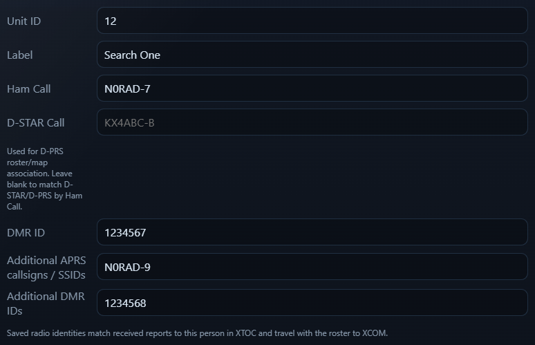

*Save the radio identities on the person. The example uses demonstration data.*

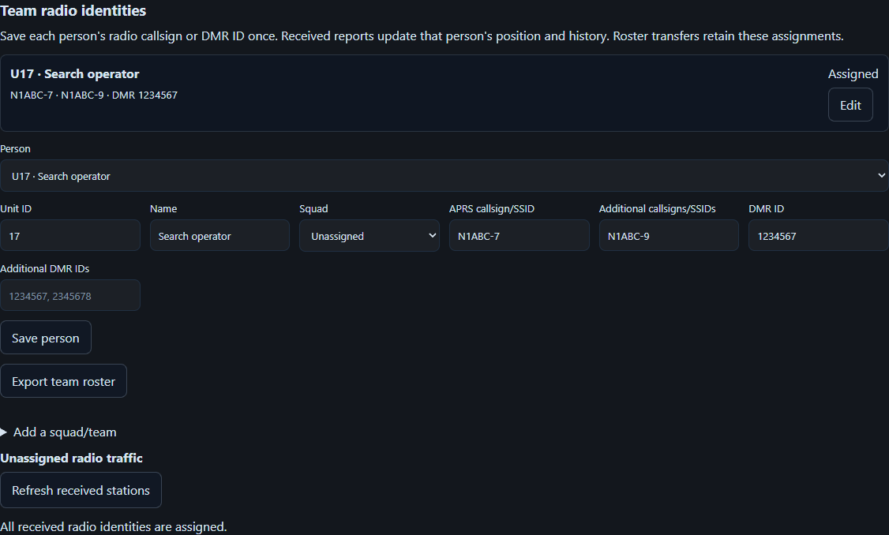

*XCOM saves the same identity fields and carries them in its roster exchange. The person and radio identifiers are demonstration data.*

APRS matching includes the SSID: a saved portable callsign ending in `-7` can be separate from a vehicle ending in `-9`. Additional aliases let one person use both. DMR matching uses the numeric source ID received over the DMR link. Saved assignments remain with the roster through application restarts and backups.

An unfamiliar sender appears under **Received radio assignments** in Team. Choose **Assign to person**; the application saves that identity and processes the retained report. A conflicting assignment identifies the people sharing that identity so you can correct it in Team.

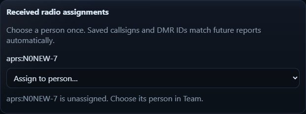

*Assign a newly received callsign to its person directly from Team. The received frame in this example is simulated.*

## Install, update and recover the radio

**Firmware flasher: BETA — Use at your own risk.** Make an original radio backup before installing or updating firmware, and keep it for recovery.

Use the installed application's bundled firmware tools with the radio's programming/data cable. Keep the radio powered and the cable connected throughout the operation. The application displays the required radio-mode and restart actions.

1. Open **Digi Modes → APRS**, locate the X Suite radio card, choose **Find radios** and select the radio. In XCOM, select **Bridge connection** to show **X Suite radio · programming cable**.
2. In XTOC, open **Firmware & recovery**. In XCOM, expand **Radio firmware · backup, install and restore**.
3. Choose **Back up radio** and wait for completion. The application retains the original firmware and radio data for recovery.
4. Select the matching **Original backup**, then choose **Install / update firmware** in XTOC. In XCOM, choose the matching **Saved backup** and **Install / update X Suite Radio**. Review any channel-conversion notes presented for the stock radio, and accept the installation when ready.
5. Follow the displayed radio-mode instructions. Wait for the completion result and restart the radio when requested.
6. Choose **Connect radio** and read its identity and state. Check the carried-over channels and save the field-reporting choices below.

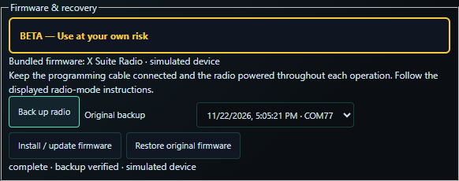

*Back up the radio, select its original backup and review the BETA warning before choosing Install / update firmware. The device and backup in this actual application capture are simulated.*

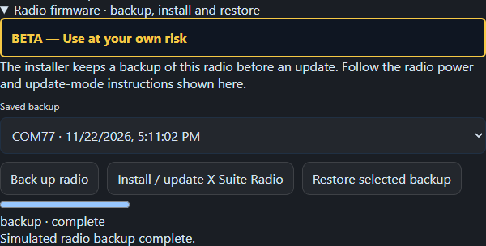

*Keep the saved backup selected and review BETA — Use at your own risk before installing. This actual application capture uses a simulated helper and radio.*

For recovery in XTOC, select that radio's **Original backup** and choose **Restore original firmware**. In XCOM, choose its **Saved backup** and **Restore selected backup**. Keep the original backup with the radio's maintenance records. The firmware tools check the selected package and backup before writing, preserve the radio's own voice codec through the supported local process, and show progress and recovery instructions in the application.

## Connect the receiving radio

Use a DM-32UV running X Suite Radio firmware, its programming/data cable and the installed XTOC or XCOM application. Keep the radio's normal operating callsign/DMR ID and the agreed channel settings. Select frequencies, power, bandwidth and radio service appropriate to the operators and deployment. The APRS profile carries clear reports.

1. Connect the radio's programming cable to the computer and switch the radio on.
2. Open **Digi Modes → APRS** and locate **X Suite Radio · DM-32UV** in XTOC. In XCOM, choose **Bridge connection** to show **X Suite radio · programming cable**.
3. Choose **Find radios**, select the connected radio and choose **APRS / AX.25** or **DMR data** using XTOC's **Radio path** or XCOM's **Packet mode**.
4. Choose **Connect radio**. Read the connected callsign/DMR ID, GPS state and radio activity shown below the controls.
5. Keep automatic packet import enabled. Send **Check in / OK** from a field radio and open that person's entry in Team and Check-ins.

The connection is saved. The application restores it and reconnects when the radio returns. **Find radios** refreshes the device list after changing a cable or computer port. The direct X Suite connection uses the radio's normal host link over the programming cable.

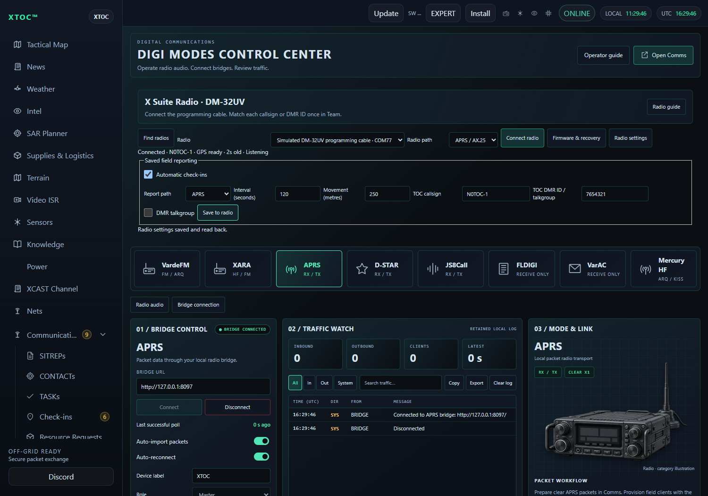

*Start at the X Suite Radio card above the bridge activity. This overview uses the actual application with a simulated programming-cable radio.*

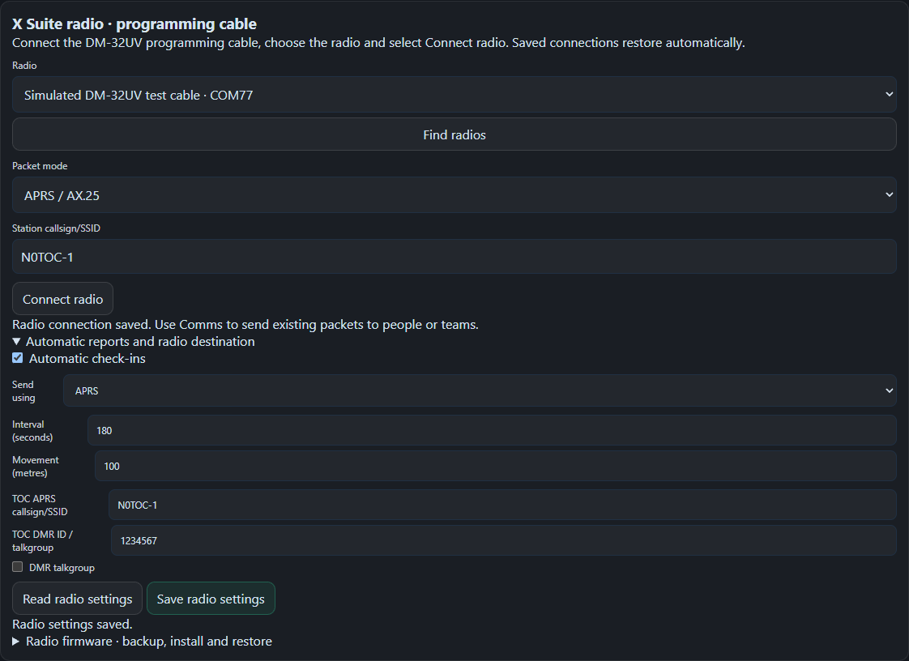

*Select the programming-cable radio and its reporting path. The connected device and readings in this example are simulated.*

An existing KISS TNC or suitable FM radio/audio interface can also receive APRS. Use the corresponding normal **Digi Modes → APRS** connection. The same Team assignments apply to supported decoded positions and structured reports arriving through those paths.

## Enable automatic check-ins

On the field radio, open **Tools → X Suite**. **Automatic check-ins** starts off so you can establish the intended radio channel before enabling reporting. Its saved default **Report interval** is five minutes.

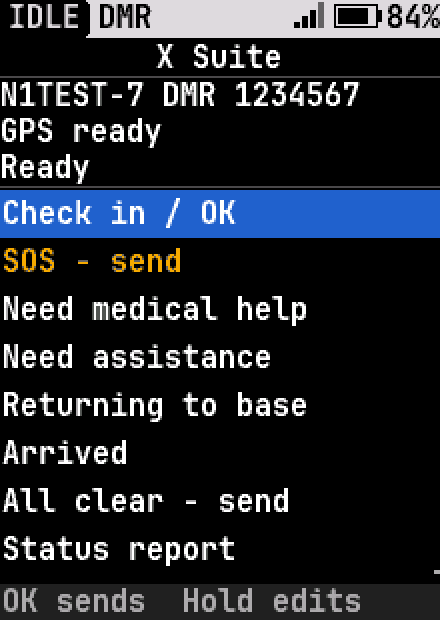

*Actual firmware UI running in the radio simulator. Select the required field action with the radio's menu keys.*

1. Select **Send via** to choose **APRS**, **DMR** or **Both**.
2. Select **Report interval** to choose the reporting interval for the team.
3. Set **Movement reporting** when position updates should also follow movement. Its choices are off, 100, 250, 500 or 1,000 metres.
4. Enable **Automatic check-ins**.
5. Wait for a current GPS fix, then confirm the first automatic update in XTOC or XCOM.

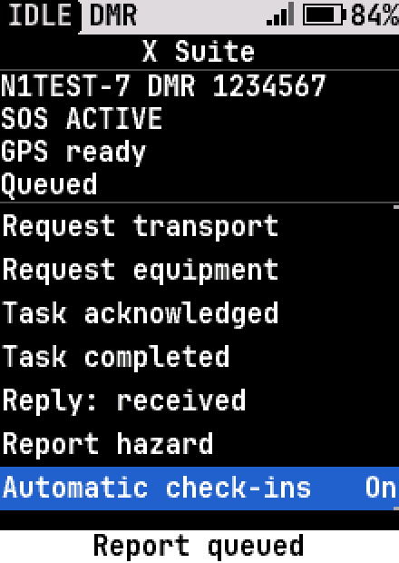

*Actual firmware simulator showing the saved automatic reporting choice; radio traffic in the simulator is simulated.*

From XTOC, **Radio settings** opens the same saved field-reporting configuration. Set **Automatic check-ins**, **Report path**, **Interval (seconds)** and **Movement (metres)**. Enter the receiving station's **TOC callsign** or **TOC DMR ID / talkgroup** as appropriate, select **DMR talkgroup** when applicable, then choose **Save to radio**.

DMR uses the radio's selected channel/contact when the TOC destination is unset; an explicit TOC DMR ID overrides it.

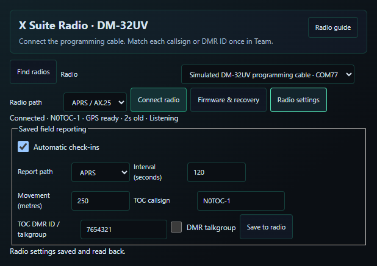

*XTOC discovers the selected cable and reads back the radio settings. The example device, GPS readings and helper responses are simulated.*

In XCOM, expand **Automatic reports and radio destination** and choose **Read radio settings**. Use **Send using** for the report path, **TOC APRS callsign/SSID** for the receiving APRS station and **Save radio settings** to store the choices. Both applications read back the saved settings.

Automatic reporting uses the radio's position service. The radio defers ordinary reporting while a voice call needs the channel and resumes afterward. Read the GPS state and report age when locating a person. A selected assistance report can be sent while GPS is acquiring; its report carries the available location state.

## Send a report from the radio

Open **Tools → X Suite** and select the required action. A complete quick action queues its report immediately. Use **Check in / OK** to send the current position and normal status, **Returning to base** for the return movement, or **Arrived** at the destination.

For a report that needs more detail, hold **OK** on its menu choice to open **Edit report**. Set **Text / note**, **Quantity / count** or **Priority** as appropriate, then select **Send report**. **Write message** opens the short MESSAGE editor directly. The standard presets remain available as immediate choices.

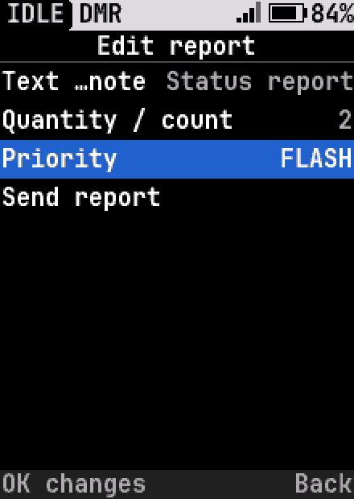

*Hold OK to edit a report before sending. This is the actual firmware UI in the radio simulator.*

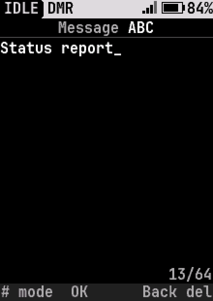

*Use the radio's existing text editor for a short note. Actual firmware simulator capture with demonstration text.*

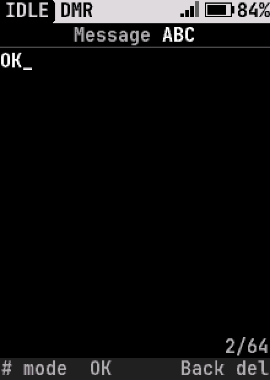

*Write message uses the existing keypad text editor. This actual firmware simulator capture shows the demonstration reply “OK”.*

| Choice | Field use |
| --- | --- |
| **SOS - send** | Immediate distress report with the available position |
| **Need medical help** | Medical assistance request |
| **Need assistance** | General assistance request |
| **Status report** | Short SITREP |
| **Report observation** | CONTACT report |
| **Report hazard** | Hazard EVENT |
| **Request water / food / fuel / medical supplies / transport / equipment** | Preset resource request |
| **Task acknowledged** | Acknowledge the received task |
| **Task completed** | Report task completion |
| **Reply: received** | Short message reply |

The common transfer path carries the existing clear XTOC report families. Use XTOC/XCOM's normal composer for detailed tasks, messages, assets, missions, routes, zones and phase lines; supported received reports appear under **Received reports** on the radio. Longer payloads travel as bounded parts and are imported after completion.

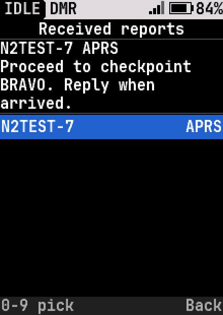

*Open Received reports to read the decoded field instruction. Actual firmware simulator with a simulated MESSAGE from the receiving station.*

## SOS and all clear

Select **SOS - send** for the radio's distress action. XTOC/XCOM links the report to its person and shows an active radio alert. Subsequent automatic check-ins continue to update the position while the distress state remains active. Radio and application restarts preserve that state.

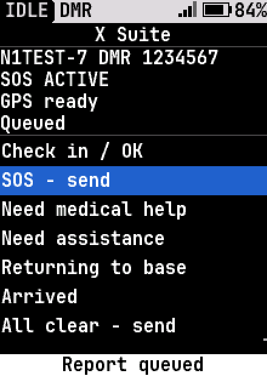

*Actual firmware simulator after the SOS action. The radio and RF path in this illustration are simulated.*

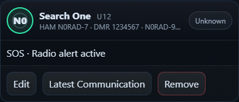

*The SOS remains active while position reports continue. The example uses simulated incoming radio frames.*

When the situation is resolved, select **All clear - send** on the same radio. The application clears the active distress state after importing that explicit report. A routine OK check-in or ordinary message continues the communication history while preserving the SOS state.

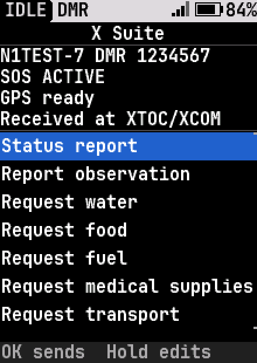

*The radio displays the received application confirmation. This actual firmware simulator capture uses a simulated confirmation frame.*

Use the deployment's normal emergency voice procedure alongside the radio report. Select the appropriate P.A.C.E. fallback when an expected receiving station is unavailable.

## Send from XTOC or XCOM to the field

In XTOC, open **Communication → Create packet**, choose the packet type and fill its normal fields. Set **Transport profile** to **APRS / DMR Radio**, then choose **CLEAR + Copy** to stage the existing packet. Under **Radio recipients**, choose the saved person, **Team ·** followed by a squad name, **All saved team radios**, or **All radios on selected channel**. **Use packet destination** uses the person addressed in a destination-bearing packet. Choose **Send via APRS** or **Send via DMR**, matching the connected radio's saved **Radio path**.

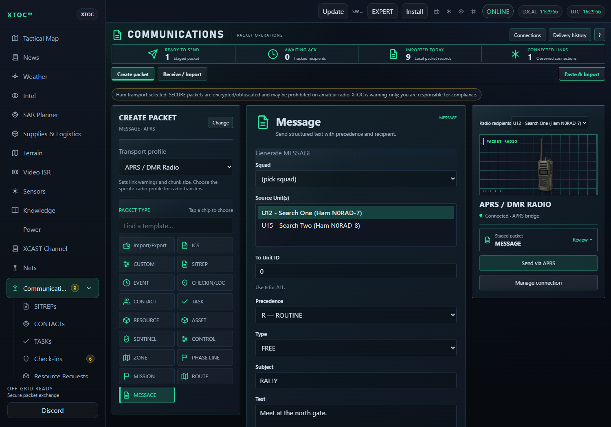

*The normal composer and radio transfer controls share the same workspace. Demonstration message and simulated radio connection.*

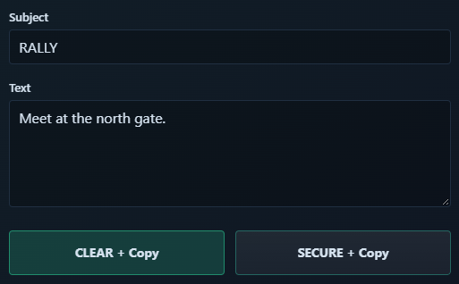

*Fill the normal MESSAGE fields, then choose CLEAR + Copy to stage the packet.*

*Choose the radio recipients beside the staged packet. This example uses the actual MESSAGE composer with demonstration data and a simulated programming-cable receiver.*

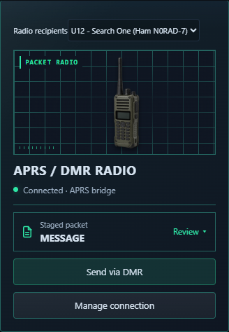

*For DMR, the saved person supplies the recipient's DMR ID. This example sends to Search One's saved ID 1234567; the helper and receiver are simulated.*

In XCOM, use the existing **Comms** packet composer. **Send to** displays the saved callsign/DMR ID and the action is **Send via APRS** or **Send via DMR**. The saved radio path selects the carriage; the roster supplies the recipient's radio address.

The same composer supports short messages, tasking, resource traffic and other existing packet types. A squad selection uses the saved people in that squad. Retain the resulting packet and delivery/activity entry so you can see the actual submission and any received response.

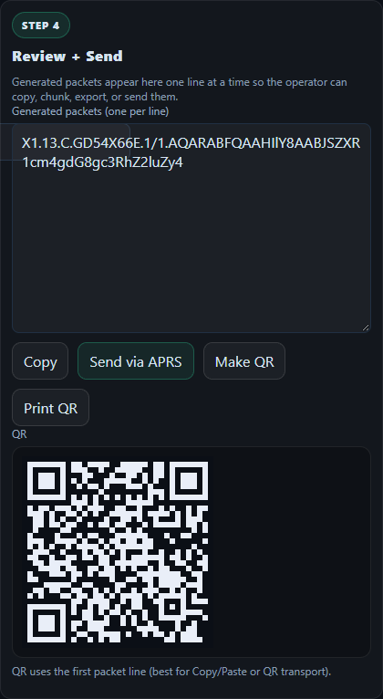

*Create and send through the existing Comms composer. This example contains a demonstration message.*

**Queued** and **Queued on radio** record local acceptance. **Sent · unconfirmed** records a transmit result. Application confirmation records import into XTOC or XCOM.

## Keep a working field setup

Before deployment, send a check-in, an exercise assistance report and an all-clear through the intended receive path. Open the matched person's record and confirm the callsign/DMR ID, report time, location and response. Save the accepted roster and application backup.

| What needs attention | Normal recovery |
| --- | --- |
| Radio is absent from the list | Check its power and programming cable, then choose **Find radios** |
| A saved radio is reconnecting | Reconnect the cable and let the application restore the saved connection |
| Position is acquiring or old | Give the GPS antenna a suitable view of the sky and read the latest fix age |
| Traffic appears as unassigned | Open **Team → Received radio assignments** and assign its person |
| Identity is assigned twice | Correct the listed callsign/DMR assignment in Team, then process the retained traffic |
| Report remains queued | Read the radio's channel/activity state and the connected path; voice and channel availability affect sending |
| A long report has missing parts | Keep reception running for completion or resend the report through its normal delivery controls |

For receiver options, use the [Radio Control Center guide](https://www.mkme.org/xtoc/guides/radio-control-center.html). The [Quick Reference Handbook](https://www.mkme.org/xtoc/guides/xtoc-xcom-quick-reference-handbook.html) supplies the short field card; the [MILSIM](https://www.mkme.org/xtoc/guides/milsim-ops-x-suite-guide.html) and [Disaster Operations](https://www.mkme.org/xtoc/guides/disaster-ops-x-suite-guide.html) guides place this radio workflow beside their communications procedures.
